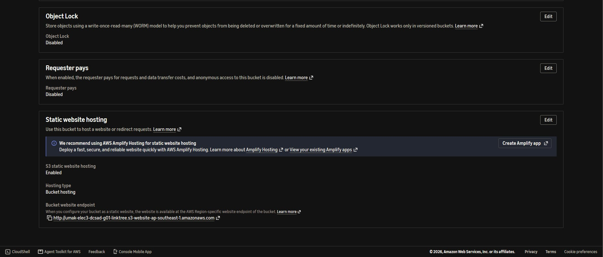
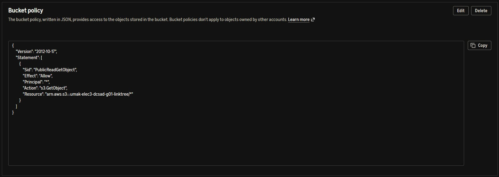
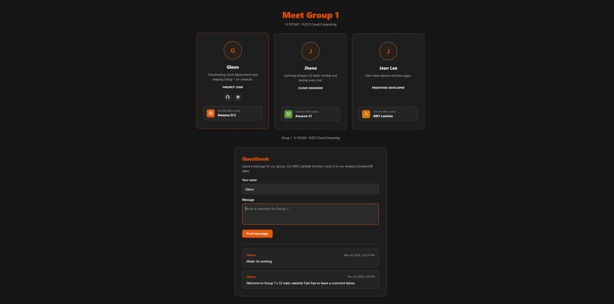

# Seatwork 3 Submission

## About us

- Group number: 01
- Section: IV-DCSAD
- Group IAM user: dcsad-g01
- Bucket name: umak-elec3-dcsad-g01-linktree
- Website endpoint: http://umak-elec3-dcsad-g01-linktree.s3-website-ap-southeast-1.amazonaws.com

## Screenshots

## Contribution

| GitHub username | What this groupmate did |
| --- | --- |
| `@RoadriguezGlenn` | Configured S3 static website hosting, applied the public-read `s3:GetObject` bucket policy, integrated all 3 member cards and the interactive Guestbook timestamp board, and opened the Pull Request. |
| `Jhone` | Configured initial S3 bucket settings in `ap-southeast-1`, verified static hosting endpoint connectivity, and tested external links. |
| `Jean Lee` | Designed the dark-mode responsive card layout, styled AWS service badges, and audited the page for visual accuracy. |
