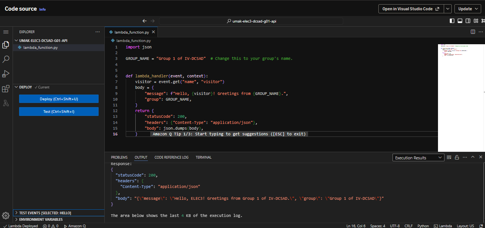
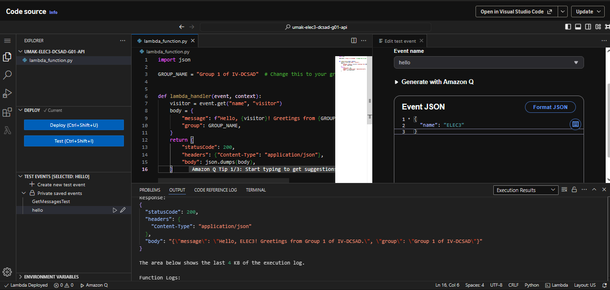
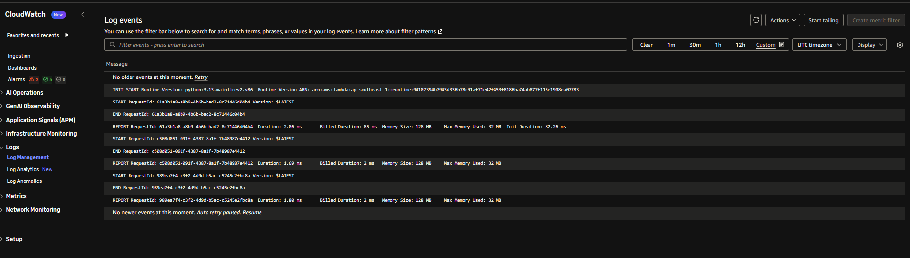

# Seatwork 4 Submission

## About us

* Group number: 01
* Section: IV-DCSAD
* Group IAM user: dcsad-g01
* Function name: umak-elec3-dcsad-g01-api

## Handler code

```python
import json

GROUP_NAME = "Group 1 of IV-DCSAD"  # Change this to your group's name.


def lambda_handler(event, context):
    visitor = event.get("name", "visitor")
    body = {
        "message": f"Hello, {visitor}! Greetings from {GROUP_NAME}.",
        "group": GROUP_NAME,
    }
    return {
        "statusCode": 200,
        "headers": {"Content-Type": "application/json"},
        "body": json.dumps(body),
    }
```

## REPORT lines

First run, a cold start:

```text
REPORT RequestId: 61a3b1a8-a8b9-4b6b-bad2-8c71446d04b4	Duration: 2.06 ms	Billed Duration: 85 ms	Memory Size: 128 MB	Max Memory Used: 32 MB	Init Duration: 82.26 ms
```

Second run, a warm start:

```text
REPORT RequestId: c508d051-091f-4387-8a1f-7b48987e4412	Duration: 1.69 ms	Billed Duration: 2 ms	Memory Size: 128 MB	Max Memory Used: 32 MB
```

## Question

Why does the second REPORT line have no Init Duration?

The second run was a warm start that reused the already initialized execution environment from the first invocation[cite: 6, 7]. Because the Python 3.13 runtime and handler code were already loaded into memory, AWS Lambda did not need to initialize a new container, so `Init Duration` was skipped[cite: 6, 7, 12].

## Screenshots







## Contribution

| GitHub username | What this groupmate did |
| --- | --- |
| RoadriguezGlenn | Deployed the Lambda handler code, executed the `hello` test event twice, collected CloudWatch `REPORT` logs, and submitted the Pull Request[cite: 3, 5, 6, 7]. |
| <jhone-github-username> | Verified IAM execution role configuration (`umak-elec3-dcsad-g01-lambda-role`) and reviewed Lambda function setup[cite: 1, 2]. |
| <jean-lee-github-username> | Verified screenshot redaction (top bar and ARN checks) and reviewed `submission.md` formatting[cite: 7]. |
